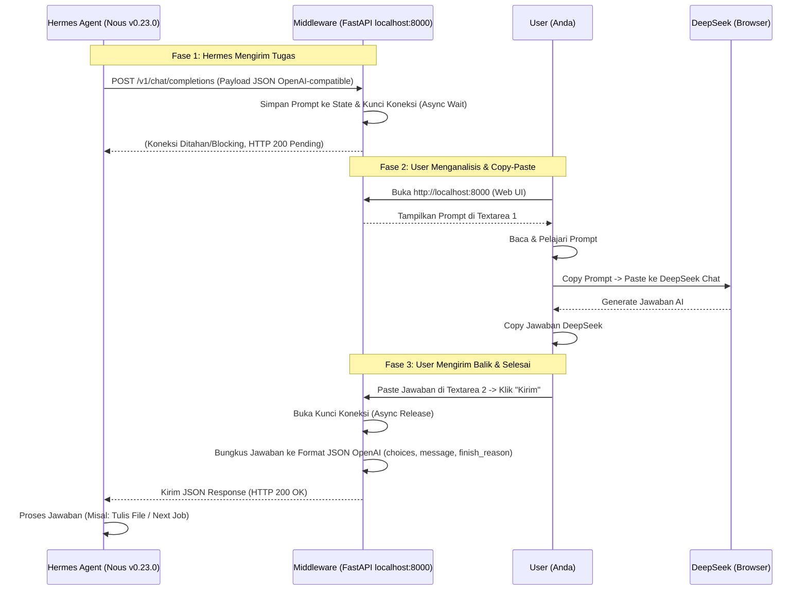

# 📘 Blueprint Proyek: Hermes Manual Bridge (Human-in-the-Loop)

## 1. Ringkasan Eksekutif
**Hermes Manual Bridge** adalah aplikasi middleware lokal berbasis web yang berfungsi sebagai jembatan "Human-in-the-Loop" (HITL) antara **Hermes Agent (Nous Research)** dan **DeepSeek Chat (via Browser)**.

**Definisi Kritis "Hermes" dalam Proyek Ini:**
- **Yang Kita Gunakan**: **Hermes Agent (v0.23.0)** oleh Nous Research. Ini adalah *agent orchestrator* open-source (CLI/Gateway) yang mengatur alur kerja, penggunaan tools, dan reasoning.
- **Yang TIDAK Kita Gunakan**: Model LLM Hermes (karena inferensi berat). Sebagai gantinya, Hermes Agent dikonfigurasi untuk mengirim request ke middleware lokal kita, yang kemudian kita teruskan secara manual ke DeepSeek via browser.
- **Alasan Pemilihan**: Pertimbangan biaya dan efisiensi resource. Hermes Agent adalah alternatif open-source yang sangat capable dibandingkan solusi berbayar seperti Claude Code, dan sangat ringan untuk laptop Acer E14 karena inferensi sebenarnya terjadi di cloud (DeepSeek).

**Tujuan Utama:**
1. **Edukasi**: Memungkinkan pengguna membaca, menganalisis, dan mempelajari prompt yang dihasilkan agen AI serta respons dari model AI.
2. **Kepatuhan & Keamanan**: Mematuhi Terms of Service (ToS) DeepSeek dengan metode copy-paste manual, serta mencegah AI menulis file secara serampangan di hardisk (sandboxing manual).
3. **Optimasi Hardware**: Menjalankan agen AI canggih tanpa membebani CPU/RAM laptop karena inferensi berat dialihkan ke browser (DeepSeek).

## Lingkungan kerja
- OS Lubuntu 24
- path root project "/home/farhan/Proyek/Hermes"
- path installasi hermes : "/home/farhan/.hermes"
- alat editing : `featherpad` dan `Visual Studio Code`
- Hardware : Acer E-14 E5-475G-38LQ RAM masih 4GB
- Processor intel Core i3-600U(2.0 GHz, 3MB L3 Cache)

## 3. Arsitektur Sistem & Diagram Alur
Sistem terdiri dari 3 entitas utama: **Hermes Agent (Klien)**, **Middleware FastAPI (Server & UI)**, dan **User/DeepSeek Browser (Eksternal)**.

## 4. Stack Teknologi & Konfigurasi Saat Ini
- **Klien (Agent)**: Hermes Agent v0.23.0 (Nous Research). 
  - *Manager*: `uv` (v0.13.5)
  - *Config*: `~/.hermes/config.yaml` & `~/.hermes/.env`
  - *Endpoint Target*: `http://localhost:8000/v1` (Chat Completions mode)
  - *Model Name*: `deepseek-manual` (Custom display name)
- **Backend Middleware**: Python 3.12.3, FastAPI, Uvicorn (ASGI Server).
- **Frontend (Web UI)**: HTML5, CSS3, Vanilla JavaScript (Disajikan langsung oleh FastAPI, tanpa framework berat).
- **State Management**: `asyncio.Event` (Python built-in) untuk menangani mekanisme *hold & wait* tanpa memblokir thread utama.

## 5. Modul & Fitur Inti (MVP - Minimum Viable Product)
**Modul A: Mock OpenAI API Gateway**
- **Endpoint**: `POST /v1/chat/completions`
- **Fungsi**: Menerima payload JSON standar OpenAI dari Hermes Agent. Mengekstrak pesan terakhir (`messages[-1].content`).
- **Mekanisme Kunci**: Menggunakan `asyncio.Event` untuk "menahan" respons HTTP hingga user menekan tombol submit di Web UI.

**Modul B: Web UI Dashboard**
- **Endpoint**: `GET /` (Root)
- **Fungsi**: Menyajikan antarmuka visual untuk user.
- **Komponen UI**: 
  - Status Bar: Menunjukkan status (Menunggu Hermes / Prompt Diterima / Terkirim).
  - Textarea 1 (Read-only): Menampilkan prompt dari Hermes.
  - Textarea 2 (Editable): Tempat user mem-paste jawaban DeepSeek.
  - Tombol Submit: Memicu pelepasan kunci API.
  - Polling: Script JS sederhana melakukan polling setiap 2 detik ke endpoint `/get_prompt` untuk memperbarui UI secara real-time.

**Modul C: State & Data Handler**
- **Endpoint**: `GET /get_prompt` & `POST /submit_response`
- **Fungsi**: Mengelola pertukaran data antara Web UI (User) dan API Gateway (Hermes).

## 6. Manajemen Risiko & Mitigasi
| Risiko | Dampak | Mitigasi |
| --- | --- | --- |
| **HTTP Timeout dari Hermes** | Hermes menganggap middleware error dan membatalkan tugas. | 1. Gunakan `asyncio` non-blocking di FastAPI.   2. Konfigurasi `timeout` di sisi Hermes Agent (`~/.hermes/config.yaml`) menjadi sangat panjang (misal: 600 detik). |
| **Data Hilang saat Refresh** | User tidak sengaja me-refresh halaman Web UI, prompt hilang. | Simpan state sementara di `localStorage` browser menggunakan JavaScript. |
| **Format JSON Salah** | Hermes menolak respons karena format tidak sesuai standar OpenAI. | Pastikan struktur JSON respons (`choices`, `message`, `finish_reason`) 100% meniru standar OpenAI Chat Completions. |

## 7. Roadmap Pengembangan (Phased Approach)

### 🟢 Fase 1: Foundation (MVP) - **STATUS: SETUP HERMES SELESAI**
- [x] **Install & Konfigurasi Hermes Agent (v0.23.0)**: Sudah selesai. Endpoint diarahkan ke `http://localhost:8000/v1` dengan model `deepseek-manual`.
- [ ] Setup environment Python & install FastAPI, Uvicorn untuk Middleware.
- [ ] Implementasi Endpoint `POST /v1/chat/completions` dengan mekanisme `asyncio.Event` (Hold & Wait).
- [ ] Implementasi Web UI dasar (HTML/JS) untuk melihat prompt dan submit respons.
- [ ] Testing alur penuh: Hermes -> Middleware -> Browser -> Middleware -> Hermes.

### 🟡 Fase 2: Robustness & UX (Peningkatan Kualitas)
- [ ] Tambahkan fitur Riwayat (History Log): Menyimpan percakapan ke file JSON/SQLite lokal.
- [ ] Tambahkan Syntax Highlighting di Textarea (CodeMirror/Prism) agar kode dari DeepSeek mudah dibaca.
- [ ] Implementasi Edit Prompt: Memungkinkan user mengedit prompt Hermes sebelum dikirim ke DeepSeek.
- [ ] Tambahkan notifikasi suara/browser saat prompt baru masuk.

### 🟠 Fase 3: Advanced Agent Control
- [ ] Implementasi fitur "Sandbox Approval": Middleware mendeteksi jika Hermes ingin mengeksekusi perintah shell/menulis file, dan meminta konfirmasi eksplisit `[Y/N]`.
- [ ] Tambahkan fitur System Prompt Injection dari Web UI.

### 🔵 Fase 4: Hybrid Integration (Masa Depan)
- [ ] Menambahkan konfigurasi API Key (Nous Portal / Google Gemini) sebagai fallback otomatis.
- [ ] Dashboard analitik sederhana (menghitung estimasi token yang dihemat).

---
