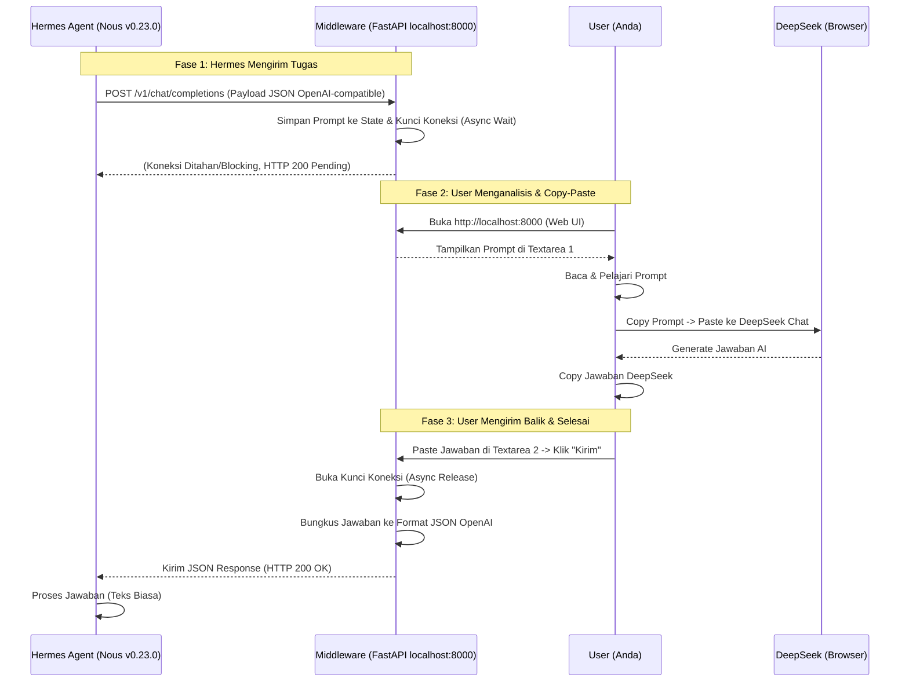
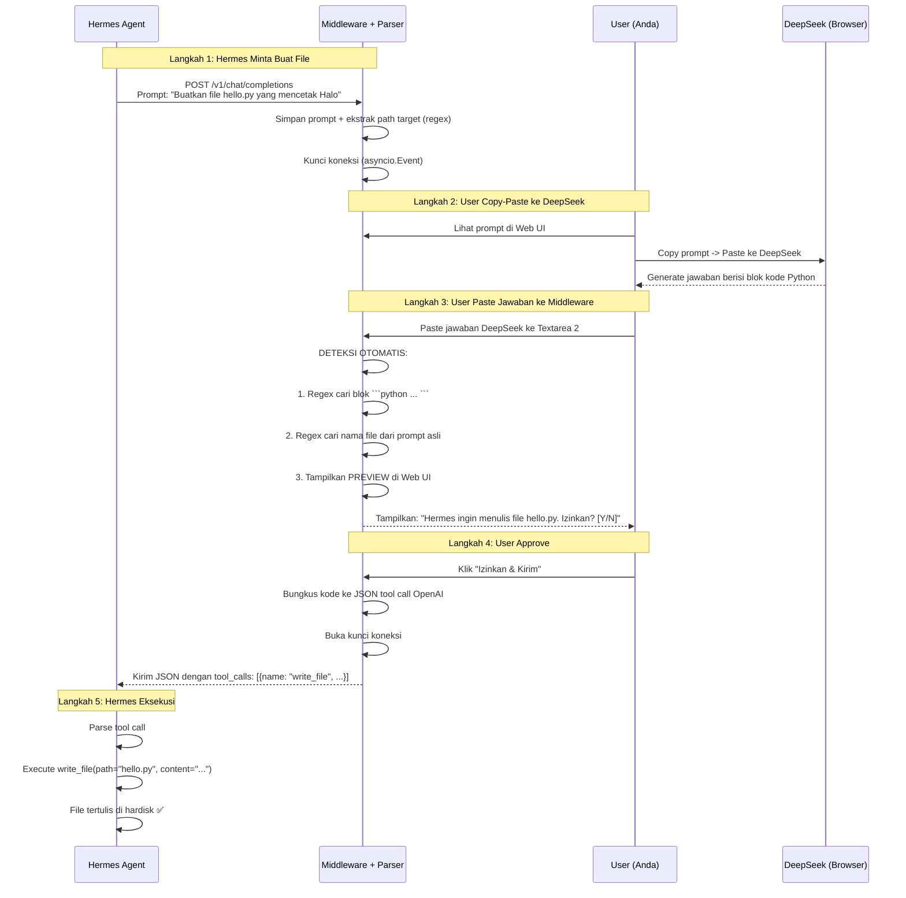

# 📘 Blueprint Proyek: Hermes Manual Bridge (Human-in-the-Loop)

## 1. Ringkasan Eksekutif

**Hermes Manual Bridge** adalah aplikasi middleware lokal berbasis web yang berfungsi sebagai jembatan "Human-in-the-Loop" (HITL) antara **Hermes Agent (Nous Research)** dan **DeepSeek Chat (via Browser)**.

### Definisi Kritis "Hermes" dalam Proyek Ini

- **Yang Kita Gunakan:** Hermes Agent (v0.23.0) oleh Nous Research. Ini adalah agent orchestrator open-source (CLI/Gateway) yang mengatur alur kerja, penggunaan tools, dan reasoning.
- **Yang TIDAK Kita Gunakan:** Model LLM Hermes (karena inferensi berat). Sebagai gantinya, Hermes Agent dikonfigurasi untuk mengirim request ke middleware lokal kita, yang kemudian kita teruskan secara manual ke DeepSeek via browser.

### Alasan Pemilihan

Pertimbangan biaya dan efisiensi resource. Hermes Agent adalah alternatif open-source yang sangat capable dibandingkan solusi berbayar seperti Claude Code, dan sangat ringan untuk laptop Acer E14 karena inferensi sebenarnya terjadi di cloud (DeepSeek).

### Tujuan Utama

1. **Edukasi:** Memungkinkan pengguna membaca, menganalisis, dan mempelajari prompt yang dihasilkan agen AI serta respons dari model AI.
2. **Kepatuhan & Keamanan:** Mematuhi Terms of Service (ToS) DeepSeek dengan metode copy-paste manual, serta mencegah AI menulis file secara serampangan di hardisk (sandboxing manual).
3. **Otomatisasi Penulisan File:** Middleware secara otomatis mengekstrak kode dari respons DeepSeek dan mengirimnya sebagai tool call ke Hermes, sehingga Hermes dapat menulis file ke hardisk secara langsung.
4. **Optimasi Hardware:** Menjalankan agen AI canggih tanpa membebani CPU/RAM laptop karena inferensi berat dialihkan ke browser (DeepSeek).

### 🔑 Keputusan Arsitektur Kunci (FASE LANJUTAN)

Berdasarkan evaluasi kebutuhan dan pengalaman pengguna dengan aplikasi C++/FLTK sebelumnya, diputuskan:

| Aspek                   | Keputusan                       | Alasan                                                                                                                                                                             |
| ----------------------- | ------------------------------- | ---------------------------------------------------------------------------------------------------------------------------------------------------------------------------------- |
| **Parsing Kode**        | **Middleware Otomatis Parsing** | Middleware mendeteksi blok kode dalam respons DeepSeek secara otomatis, mengekstrak konten, dan mengirimkannya sebagai tool call ke Hermes. User tidak perlu mengetik JSON manual. |
| **Penentuan Path File** | **Ekstrak dari Prompt Hermes**  | Middleware menganalisis prompt asli dari Hermes untuk menemukan nama file yang diminta (misal: "Buatkan file `hello.py`" → path = `hello.py`).                                     |
| **Mode Operasi**        | **Hybrid dengan Preview**       | Middleware menampilkan preview hasil parsing di Web UI sebelum mengirim ke Hermes, memberikan user kontrol penuh atas apa yang akan ditulis ke hardisk.                            |

---

## 2. Arsitektur Sistem & Diagram Alur

Sistem terdiri dari 4 entitas utama: **Hermes Agent** (Klien), **Middleware FastAPI** (Server & UI + Parser), **User** (Anda), dan **DeepSeek** (Browser).

### 2.1 Diagram Alur Utama (Fase 1 - Teks Biasa)



### 2.2 Diagram Alur Lanjutan (Fase 3 - Parsing Otomatis untuk Write File)



---

## 3. Stack Teknologi & Konfigurasi Saat Ini

| Komponen               | Detail                                                            |
| ---------------------- | ----------------------------------------------------------------- |
| **Klien (Agent)**      | Hermes Agent v0.23.0 (Nous Research)                              |
| **Manager**            | `uv` (v0.13.5)                                                    |
| **Config Hermes**      | `~/.hermes/config.yaml` & `~/.hermes/.env`                        |
| **Endpoint Target**    | `http://localhost:8000/v1` (Chat Completions mode)                |
| **Model Name**         | `deepseek-manual` (Custom display name)                           |
| **Backend Middleware** | Python 3.12.3, FastAPI, Uvicorn (ASGI Server)                     |
| **Frontend (Web UI)**  | HTML5, CSS3, Vanilla JavaScript (disajikan langsung oleh FastAPI) |
| **State Management**   | `asyncio.Event` (Python built-in) untuk mekanisme hold & wait     |
| **Parser Engine**      | `re` (Python regex built-in) untuk ekstraksi kode dan path        |

### Konfigurasi Hermes Saat Ini

```yaml
model:
  default: "deepseek-manual"
  provider: "custom"
  base_url: "http://localhost:8000/v1"
  streaming: false  # WAJIB false untuk Fase 1 & 2
```

---

## 4. Modul & Fitur Inti

### Modul A: Mock OpenAI API Gateway ✅ (SELESAI)

- **Endpoint:** `POST /v1/chat/completions`
- **Fungsi:** Menerima payload JSON standar OpenAI dari Hermes Agent. Mengekstrak pesan terakhir (`messages[-1].content`).
- **Mekanisme Kunci:** Menggunakan `asyncio.Event` untuk "menahan" respons HTTP hingga user menekan tombol submit di Web UI.

### Modul B: Web UI Dashboard ✅ (SELESAI)

- **Endpoint:** `GET /` (Root)
- **Fungsi:** Menyajikan antarmuka visual untuk user.
- **Komponen UI:**
  - Status Bar: Menunjukkan status (Menunggu Hermes / Prompt Diterima / Terkirim).
  - Textarea 1 (Read-only): Menampilkan prompt dari Hermes.
  - Textarea 2 (Editable): Tempat user mem-paste jawaban DeepSeek.
  - Tombol Submit: Memicu pelepasan kunci API.
  - Polling: Script JS melakukan polling setiap 2 detik ke `/get_prompt`.

### Modul C: State & Data Handler ✅ (SELESAI)

- **Endpoint:** `GET /get_prompt` & `POST /submit_response`
- **Fungsi:** Mengelola pertukaran data antara Web UI (User) dan API Gateway (Hermes).

### Modul D: Code Parser & Path Extractor 🟡 (FASE 3)

- **Fungsi:** Otomatis mendeteksi blok kode dalam respons DeepSeek dan mengekstrak path file dari prompt Hermes.
- **Komponen:**
  - **Code Detector:** Regex untuk mendeteksi blok kode ```python, ```bash, ```javascript, dll.
  - **Path Extractor:** Regex untuk mengekstrak nama file dari prompt Hermes (misal: "Buatkan file `X`" → path = `X`).
  - **Tool Call Builder:** Membungkus kode yang diekstrak ke format JSON tool call OpenAI.
  - **Preview Generator:** Membuat preview HTML yang ramah user sebelum dikirim ke Hermes.

### Modul E: Sandbox Approval UI 🟡 (FASE 3)

- **Fungsi:** Menampilkan dialog konfirmasi di Web UI sebelum middleware mengirim tool call ke Hermes.
- **Komponen:**
  - Panel Preview: Menampilkan nama file, bahasa, dan isi kode.
  - Tombol Approve/Reject: User memutuskan apakah file akan ditulis.
  - Editable Content: User bisa mengedit kode sebelum dikirim (opsional).

---

## 5. Detail Teknis: Parsing Otomatis (Fase 3)

### 5.1 Algoritma Ekstraksi Path dari Prompt Hermes

```python
import re

def extract_file_path_from_prompt(prompt: str) -> Optional[str]:
    """
    Ekstrak nama file dari prompt Hermes.
    Contoh:
    - "Buatkan file hello.py yang mencetak Halo" → "hello.py"
    - "Tulis kode ke test.py" → "test.py"
    - "Create a file named app.js" → "app.js"
    """
    patterns = [
        r'(?:file|berkas)\s+`?([a-zA-Z0-9_\-./]+\.[a-zA-Z0-9]+)`?',  # "file hello.py" atau "file `hello.py`"
        r'(?:named|bernama)\s+`?([a-zA-Z0-9_\-./]+\.[a-zA-Z0-9]+)`?',  # "named app.js"
        r'`([a-zA-Z0-9_\-./]+\.[a-zA-Z0-9]+)`',  # backtick-quoted filename
        r'\b([a-zA-Z0-9_\-]+\.(?:py|js|ts|html|css|json|yaml|yml|md|txt|sh|bash|cpp|c|h|java|go|rs|rb|php))\b'
    ]
    for pattern in patterns:
        match = re.search(pattern, prompt, re.IGNORECASE)
        if match:
            return match.group(1)
    return None
```

### 5.2 Algoritma Deteksi Blok Kode

```python
def extract_code_blocks(text: str) -> List[Dict[str, str]]:
    """
    Deteksi semua blok kode dalam respons DeepSeek.
    Return: [{"language": "python", "content": "..."}, ...]
    """
    pattern = r'```(\w+)?\s*\n(.*?)```'
    matches = re.findall(pattern, text, re.DOTALL)
    blocks = []
    for lang, content in matches:
        blocks.append({
            "language": lang or "text",
            "content": content.strip()
        })
    return blocks
```

### 5.3 Tool Call Builder (Format OpenAI)

```python
def build_tool_call_response(file_path: str, code_content: str, language: str) -> Dict:
    """
    Bungkus kode ke format tool call OpenAI yang dikenali Hermes.
    """
    return {
        "id": "chatcmpl-manual-toolcall",
        "object": "chat.completion",
        "created": int(time.time()),
        "model": "deepseek-manual",
        "choices": [{
            "index": 0,
            "message": {
                "role": "assistant",
                "content": None,
                "tool_calls": [{
                    "id": f"call_{uuid.uuid4().hex[:8]}",
                    "type": "function",
                    "function": {
                        "name": "write_file",
                        "arguments": json.dumps({
                            "path": file_path,
                            "content": code_content
                        })
                    }
                }]
            },
            "finish_reason": "tool_calls"
        }],
        "usage": {
            "prompt_tokens": 0,
            "completion_tokens": 0,
            "total_tokens": 0
        }
    }
```

### 5.4 Logika Keputusan Parser

```
INPUT: Respons DeepSeek (teks) + Prompt Hermes (teks)
│
├─ Apakah ada blok kode (```...```)?
│   ├─ TIDAK → Kirim sebagai teks biasa (Fase 1 behavior)
│   └─ YA → Lanjut ke langkah berikutnya
│
├─ Apakah bisa ekstrak path dari prompt Hermes?
│   ├─ TIDAK → Tampilkan dialog "Masukkan nama file manual"
│   └─ YA → Lanjut ke langkah berikutnya
│
├─ Tampilkan PREVIEW di Web UI:
│   "Hermes ingin menulis file: [path]
│    Bahasa: [language]
│    Ukuran: [N] karakter
│    [Isi kode dalam preview box]
│    [Izinkan] [Edit & Izinkan] [Tolak]"
│
└─ User klik "Izinkan" → Bungkus ke tool call JSON → Kirim ke Hermes
```

---

## 6. Manajemen Risiko & Mitigasi

| Risiko                                | Dampak                                                                    | Mitigasi                                                                                                                                                                    |
| ------------------------------------- | ------------------------------------------------------------------------- | --------------------------------------------------------------------------------------------------------------------------------------------------------------------------- |
| HTTP Timeout dari Hermes              | Hermes menganggap middleware error dan membatalkan tugas                  | 1. Gunakan `asyncio` non-blocking di FastAPI.<br/>2. Konfigurasi `timeout` di sisi Hermes Agent (`~/.hermes/config.yaml`) menjadi sangat panjang (1800 detik).              |
| Data Hilang saat Refresh              | User tidak sengaja me-refresh halaman Web UI, prompt hilang               | Simpan state sementara di `localStorage` browser menggunakan JavaScript.                                                                                                    |
| Format JSON Salah                     | Hermes menolak respons karena format tidak sesuai standar OpenAI          | Pastikan struktur JSON respons (`choices`, `message`, `finish_reason`) 100% meniru standar OpenAI Chat Completions.                                                         |
| **Parsing Salah Deteksi** (FASE 3)    | Middleware salah mengira teks biasa sebagai kode, atau salah ekstrak path | 1. **Preview wajib** sebelum kirim ke Hermes.<br/>2. User bisa reject jika parsing salah.<br/>3. Fallback ke mode teks biasa jika parsing gagal.                            |
| **Path File Berbahaya** (FASE 3)      | Hermes menulis file ke lokasi sensitif (misal: `/etc/passwd`)             | 1. **Whitelist direktori** di middleware (hanya boleh tulis di `/home/farhan/Proyek/Hermes/`).<br/>2. **Block path absolut** yang mencurigakan.<br/>3. User approval wajib. |
| **Kode Berbahaya** (FASE 3)           | DeepSeek menghasilkan kode berbahaya (misal: `rm -rf /`)                  | 1. **Preview wajib** dengan syntax highlighting.<br/>2. User bisa edit kode sebelum approve.<br/>3. Sandbox approval gate.                                                  |
| **Regex Gagal Ekstrak Path** (FASE 3) | Prompt Hermes tidak mengandung pola yang dikenali                         | Fallback ke dialog input manual di Web UI untuk memasukkan path.                                                                                                            |

---

## 7. Roadmap Pengembangan (Phased Approach)

### 🟢 Fase 1: Foundation (MVP) — STATUS: ✅ SELESAI

- [x] Install & Konfigurasi Hermes Agent (v0.23.0). Endpoint diarahkan ke `http://localhost:8000/v1` dengan model `deepseek-manual`.
- [x] Setup environment Python & install FastAPI, Uvicorn untuk Middleware.
- [x] Implementasi Endpoint `POST /v1/chat/completions` dengan mekanisme `asyncio.Event` (Hold & Wait).
- [x] Implementasi Web UI dasar (HTML/JS) untuk melihat prompt dan submit respons.
- [x] Testing alur penuh: Hermes -> Middleware -> Browser -> Middleware -> Hermes.
- [x] Konfigurasi SSH Git untuk push tanpa password ke GitHub.
- [x] Commit dan push progress ke repository GitHub.

### 🟡 Fase 2: Robustness & UX (Peningkatan Kualitas) — STATUS: 🔲 DIANGGAP SELESAI

- [x] Tambahkan fitur Riwayat (History Log): Menyimpan percakapan ke file JSON/SQLite lokal.
- [x] Tambahkan Syntax Highlighting di Textarea (CodeMirror/Prism) agar kode dari DeepSeek mudah dibaca.
- [x] Implementasi Edit Prompt: Memungkinkan user mengedit prompt Hermes sebelum dikirim ke DeepSeek.
- [ ] Tambahkan notifikasi suara/browser saat prompt baru masuk. --> bagian ini belum diperlukan (PENDING)
- [x] Tambahkan fitur "Clear Draft" untuk menghapus draft jawaban yang tersimpan di localStorage.

### 🟠 Fase 3: Advanced Agent Control (Parsing Otomatis) — STATUS: 🔲 BELUM DIMULAI

**Fokus:** Middleware otomatis parsing respons DeepSeek dan mengirim tool call ke Hermes.

- [ ] **Modul D: Code Parser & Path Extractor**
  - [ ] Implementasi fungsi `extract_code_blocks()` untuk deteksi blok kode.
  - [ ] Implementasi fungsi `extract_file_path_from_prompt()` untuk ekstrak path dari prompt Hermes.
  - [ ] Implementasi fungsi `build_tool_call_response()` untuk bungkus ke format OpenAI tool call.
  - [ ] Unit test untuk berbagai pola prompt dan respons.
- [ ] **Modul E: Sandbox Approval UI**
  - [ ] Tambahkan panel preview di Web UI yang muncul saat kode terdeteksi.
  - [ ] Tampilkan informasi: nama file, bahasa, ukuran, isi kode.
  - [ ] Implementasi tombol "Izinkan", "Edit & Izinkan", "Tolak".
  - [ ] Implementasi editable preview (user bisa modifikasi kode sebelum approve).
- [ ] **Keamanan & Fallback**
  - [ ] Implementasi whitelist direktori (hanya boleh tulis di path tertentu).
  - [ ] Implementasi fallback ke mode teks biasa jika parsing gagal.
  - [ ] Implementasi dialog input path manual jika regex tidak bisa ekstrak.
- [ ] **Testing End-to-End**
  - [ ] Tes: Hermes minta buat file Python → DeepSeek balas dengan kode → Middleware parse → Hermes tulis file.
  - [ ] Tes: Hermes minta buat file bash script → parsing berhasil.
  - [ ] Tes: Prompt ambigu → fallback ke input manual.
  - [ ] Tes: User reject → tool call tidak dikirim.

### 🔵 Fase 4: Hybrid Integration (Masa Depan) — STATUS: 🔲 BELUM DIMULAI

- [ ] Menambahkan konfigurasi API Key (Nous Portal / Google Gemini) sebagai fallback otomatis.
- [ ] Dashboard analitik sederhana (menghitung estimasi token yang dihemat).
- [ ] Integrasi dengan aplikasi C++/FLTK existing untuk reuse parsing logic.
- [ ] Dukungan untuk multiple tool calls dalam satu respons (misal: buat beberapa file sekaligus).

---

## 8. Lingkungan Kerja

| Item                       | Detail                                                     |
| -------------------------- | ---------------------------------------------------------- |
| **OS**                     | Lubuntu 24                                                 |
| **Path Root Project**      | `/home/farhan/Proyek/Hermes`                               |
| **Path Installasi Hermes** | `/home/farhan/.hermes`                                     |
| **Alat Editing**           | `featherpad` dan `Visual Studio Code`                      |
| **Hardware**               | Acer E-14 E5-475G-38LQ, RAM 4GB                            |
| **Processor**              | Intel Core i3-600U (2.0 GHz, 3MB L3 Cache)                 |
| **Repository GitHub**      | `https://github.com/farhansyihab/hermes-manual-bridge.git` |
| **Git Auth**               | `gh` sudah terinstal, sudah login via SSH key              |
| **Struktur Direktori**     | Lihat bagian 9 di bawah                                    |

---

## 9. Struktur Direktori Proyek

```
Hermes/
├── middleware/
│   ├── requirements.txt
│   └── app/
│       ├── __init__.py
│       ├── main.py              # Entry point FastAPI
│       └── routers/
│           ├── __init__.py
│           ├── chat.py          # (Fase 3) Endpoint /v1/chat/completions
│           ├── ui.py            # (Fase 3) Endpoint Web UI
│           └── parser.py        # (Fase 3) Endpoint parsing helpers
├── planning/
│   ├── Blueprint.md             # Dokumen ini
│   └── Ringkasan.md             # Ringkasan status proyek
└── README.md                    # (Opsional) Dokumentasi publik
```

---

## 10. Catatan Penting untuk Pengembangan Fase 3

### 10.1 Prinsip Desain Parsing

1. **User-in-the-Loop Wajib:** Parsing otomatis TIDAK boleh langsung menulis file tanpa persetujuan user. Preview dan approval adalah mandatory.
2. **Fallback Graceful:** Jika parsing gagal, sistem harus kembali ke mode teks biasa (Fase 1 behavior) tanpa error.
3. **Keamanan First:** Whitelist direktori dan block path berbahaya adalah prioritas utama.
4. **Transparansi:** User harus selalu tahu apa yang akan ditulis ke hardisk sebelum approve.

### 10.2 Kriteria Keberhasilan Fase 3

- [ ] Middleware berhasil mendeteksi blok kode dalam respons DeepSeek dengan akurasi > 90%.
- [ ] Middleware berhasil mengekstrak path file dari prompt Hermes untuk pola umum.
- [ ] User bisa approve/reject setiap tool call sebelum dikirim ke Hermes.
- [ ] Hermes berhasil menulis file ke hardisk setelah approve.
- [ ] Tidak ada regresi pada Fase 1 (teks biasa tetap berfungsi).

### 10.3 Contoh Skenario Penggunaan

**Skenario 1: Buat File Python**

- User ketik di Hermes: `Buatkan file hello.py yang mencetak "Halo dari Hermes!"`

- Hermes kirim prompt ke middleware.

- User copy-paste ke DeepSeek.

- DeepSeek balas dengan:
  
  ```
  Berikut isi file hello.py:
  ```python
  print("Halo dari Hermes!")
  ```
  
  ```

- User paste ke middleware.

- Middleware deteksi: blok `python`, path `hello.py` dari prompt.

- Middleware tampilkan preview: "Hermes ingin menulis file `hello.py` (Python, 28 karakter). Izinkan?"

- User klik "Izinkan".

- Middleware bungkus ke tool call JSON, kirim ke Hermes.

- Hermes tulis file `hello.py` ke hardisk. ✅

**Skenario 2: Prompt Ambigu (Fallback)**

- User ketik di Hermes: `Tolong buatkan script untuk backup database`
- DeepSeek balas dengan beberapa opsi file.
- Middleware tidak bisa ekstrak path spesifik.
- Middleware tampilkan dialog: "Nama file tidak terdeteksi. Silakan masukkan path manual: [____]"
- User ketik: `backup.sh`
- User approve → Hermes tulis file. ✅

**Skenario 3: User Reject**

- Parsing berhasil, preview muncul.
- User melihat kode dan merasa ada yang salah.
- User klik "Tolak".
- Middleware kirim respons teks biasa: "Saya tidak ingin menulis file ini. Tolong perbaiki."
- Hermes terima dan minta perbaikan ke DeepSeek. ✅

---

## 11. Referensi & Sumber Daya

- **Hermes Agent Documentation:** https://hermes-agent.nousresearch.com/docs/
- **OpenAI Chat Completions API:** https://platform.openai.com/docs/api-reference/chat
- **FastAPI Documentation:** https://fastapi.tiangolo.com/
- **DeepSeek Chat:** https://chat.deepseek.com/
- **Aplikasi C++/FLTK Existing:** Referensi untuk logika parsing kode yang sudah terbukti bekerja.

---

## 12. Log Perubahan (Changelog)

| Tanggal    | Versi | Perubahan                                                                                                                                       |
| ---------- | ----- | ----------------------------------------------------------------------------------------------------------------------------------------------- |
| 2026-11-09 | 1.0.0 | Initial blueprint. Fase 1 selesai (MVP).                                                                                                        |
| 2026-11-09 | 1.1.0 | Tambahkan Fase 3: Parsing Otomatis (Opsi A) + Ekstrak Path dari Prompt Hermes (Opsi A). Tambahkan Modul D & E. Tambahkan detail teknis parsing. |

```

```
